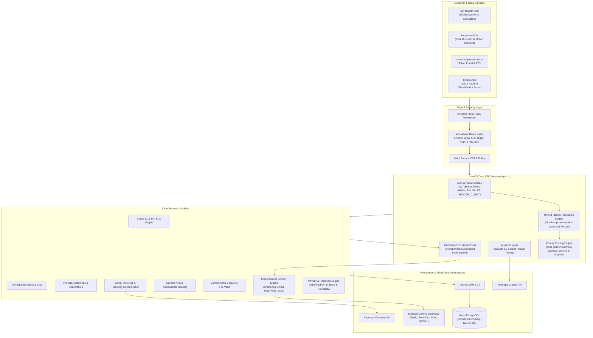

# Unified CRM System Architecture

The Karya Saarthi Unified CRM is architected as a **high-throughput, multi-tenant-ready, single-core platform** that consolidates four distinct customer-facing digital surfaces into one operational backbone.

---

## 1. High-Level Architecture Diagram

---

## 2. Multi-Surface Ingestion & Unified Identity Flow

All surfaces emit events with standard headers: `x-surface: SITE_COM | SITE_IN | CAREER | APP`.
1. **Request Reception**: Request is evaluated against the `RateLimitGuard`.
2. **Identity Resolution**: `PersonsService.findOrCreatePerson` checks if an email or phone number matches an existing `Person`.
   - If found: Updates `consentFlags`, tags, and surface timestamps.
   - If new: Creates a canonical `Person` record and tags the `firstSeenSurface`.
3. **Omnichannel Ingestion**: An `Interaction` is logged linking the raw payload and headers to the `Person`.
4. **Pipeline Routing**: If the interaction creates a `Lead`, `RoutingRules` are evaluated by priority order, assigning the appropriate `Staff` member and starting a 15-minute SLA timer.
5. **Event Bus Dispatch**: An event (e.g. `lead.created`) fires asynchronously via `CrmEventBusService`, dispatching confirmation comms (Email/WhatsApp) while checking the user's DPDP/GDPR consent preferences.

---

## 3. Security & Compliance Architecture
- **Authentication**: Stateless JWT with HMAC SHA-256 tokens; role-based route guards (`@Roles(StaffRole.ADMIN, ...)`).
- **Rate Limiting**: In-memory token bucket tracking per IP/identifier to protect public inquiry forms from spam attacks.
- **Data Privacy**: Complete erasure endpoints (`/api/v1/persons/:id/erase`) that redact PII while preserving financial audits for legal/accounting compliance.
- **Audit Logging**: Every mutation on sensitive entities (Leads, Projects, Invoices, Comms) creates an immutable record in `AuditLog`.
