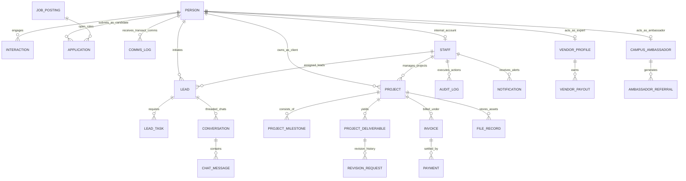

# Unified CRM Database Entity-Relationship (ER) Diagram

The Karya Saarthi Unified CRM utilizes a single relational database schema (PostgreSQL on Neon) centered around the **Unified Identity Model (`Person`)**. All four customer-facing surfaces (`karyasaarthi.com`, `karyasaarthi.in`, `career.karyasaarthi.com`, and the `Mobile App`) write to this common core.

---

## 1. Core Entity Relationship Model

---

## 2. Model Breakdown by Functional Domain

### Unified Identity & Customer Master
- **`Person`**: Central identity graph keyed on normalized `email` or `phone`. Contains role flags (`isLead`, `isClient`, `isVendor`, `isApplicant`, `isStaff`), `consentFlags` (GDPR/DPDP compliance), lifetime value, and surface origin (`firstSeenSurface`).
- **`Interaction`**: Every omnichannel touchpoint (form submission, chat message, inbound call, application) across all four surfaces linking back to `personId`.
- **`Staff`**: Internal operators (Super Admin, Sales Agent, Project Manager, Talent Lead, Finance Admin) with bcrypt credentials and RBAC roles.

### Omnichannel Inbox & Lead Pipeline
- **`Lead`**: Pipeline stage tracker (`NEW`, `CONTACTED`, `QUALIFIED`, `PROPOSAL_SENT`, `NEGOTIATION`, `WON`, `LOST`) with priority scoring, 15-minute SLA timer (`slaDueAt`, `isSlaBreached`), and estimated deal value.
- **`LeadTask`**: Actionable tasks assigned to staff with deadlines.
- **`Conversation` & `ChatMessage`**: Synchronous and asynchronous messaging threads spanning web widgets and mobile app chats.
- **`CannedReply`**: Standardized templated responses for customer support and sales enablement.
- **`RoutingRule`**: Dynamic assignment rules routing inbound leads based on surface, priority, and requested service.

### Project & Order Execution
- **`Project`**: Client engagements with budget, timeline, stage (`SCOPING`, `IN_PROGRESS`, `REVIEW`, `DELIVERED`), and assigned PM.
- **`ProjectMilestone`**: Stage gates with percentage weightage and deadlines.
- **`ProjectDeliverable`**: Work artifacts submitted for client review and acceptance.
- **`RevisionRequest`**: Structured feedback loops for iterations and changes.
- **`FileRecord`**: Encrypted asset metadata, storage path, file size, and mime-type.

### Vendor & Freelance Network
- **`VendorProfile`**: Expert roster with skills taxonomy, verification status, rating, and payout credentials.
- **`VendorPayout`**: Commission tracking, milestone-linked disbursements, and TDS deductions.

### Careers ATS & Campus Ambassador Network
- **`JobPosting`**: Role requisitions across departments, employment types, and experience levels.
- **`Application`**: Candidate pipeline (`APPLIED`, `AI_SCREENED`, `SHORTLISTED`, `INTERVIEW`, `OFFERED`, `REJECTED`, `HIRED`) with Claude Sonnet AI screening scores.
- **`CampusAmbassador`**: Student partners with unique referral handles and tier levels.
- **`AmbassadorReferral`**: Lead/applicant attribution and reward compensation.

### Billing, Dynamic Pricing & Admin Control
- **`ServiceItem`**: Standard service catalogue items with base fees and turn-around times.
- **`PricingRule`**: Conditional pricing engine (surface discounts, volume tiers, urgency surcharges).
- **`FeatureFlag`**: Runtime capability toggles partitioned per surface (`SITE_COM`, `SITE_IN`, `APP`, `CAREER`).
- **`Invoice` & `Payment`**: GST-compliant invoices with automated Razorpay order generation, signature verification, and reconciliation.

### Automation, Comms & Security
- **`AutomationRule`**: Trigger-condition-action workflow engine.
- **`CommsLog`**: Multi-channel transactional dispatch records (Email, WhatsApp, Push/FCM, SMS) with GDPR consent enforcement and delivery status.
- **`Notification`**: In-app bell notifications and real-time alerts for staff.
- **`AuditLog`**: Tamper-evident immutable ledger capturing all sensitive mutations (PII erasure, status transitions, financial operations).
